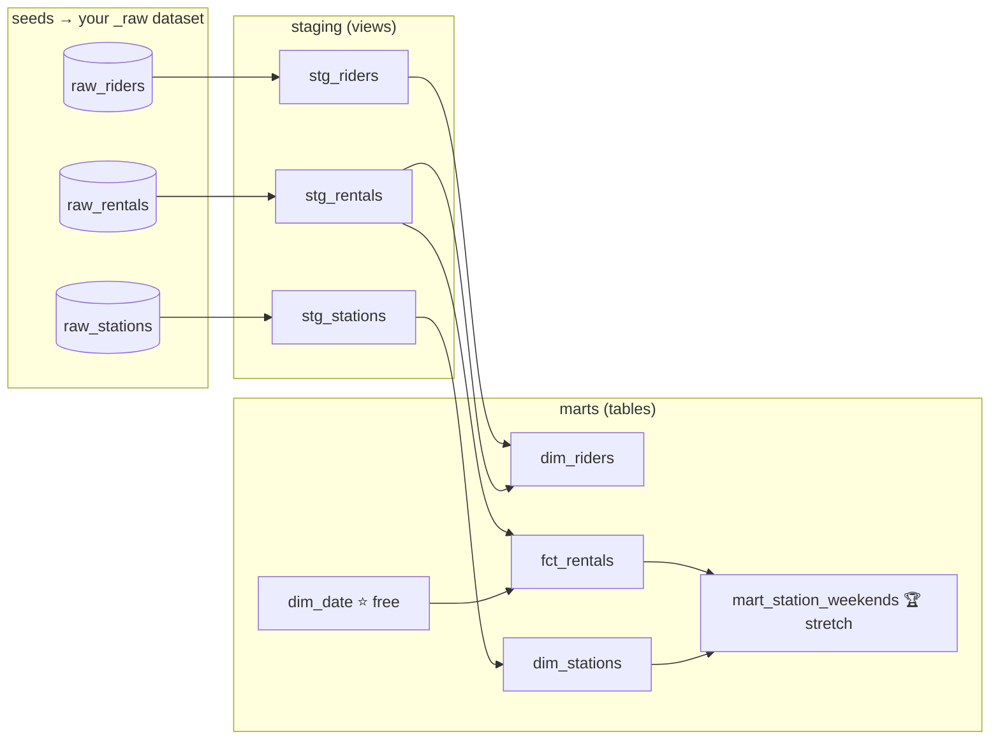

This is my branch, get lost!!!!!!!!!!!!!!!!!!!!!!!!!!!!!!!!!!!!!!!
This is my branch, get lost!!!!!!!!!!!!!!!!!!!!!!!!!!!!!!!!!!!!!!!
This is my branch, get lost!!!!!!!!!!!!!!!!!!!!!!!!!!!!!!!!!!!!!!!
This is my branch, get lost!!!!!!!!!!!!!!!!!!!!!!!!!!!!!!!!!!!!!!!
This is my branch, get lost!!!!!!!!!!!!!!!!!!!!!!!!!!!!!!!!!!!!!!!
This is my branch, get lost!!!!!!!!!!!!!!!!!!!!!!!!!!!!!!!!!!!!!!!
This is my branch, get lost!!!!!!!!!!!!!!!!!!!!!!!!!!!!!!!!!!!!!!!
This is my branch, get lost!!!!!!!!!!!!!!!!!!!!!!!!!!!!!!!!!!!!!!!
This is my branch, get lost!!!!!!!!!!!!!!!!!!!!!!!!!!!!!!!!!!!!!!!
This is my branch, get lost!!!!!!!!!!!!!!!!!!!!!!!!!!!!!!!!!!!!!!!
This is my branch, get lost!!!!!!!!!!!!!!!!!!!!!!!!!!!!!!!!!!!!!!!
This is my branch, get lost!!!!!!!!!!!!!!!!!!!!!!!!!!!!!!!!!!!!!!!
This is my branch, get lost!!!!!!!!!!!!!!!!!!!!!!!!!!!!!!!!!!!!!!!
This is my branch, get lost!!!!!!!!!!!!!!!!!!!!!!!!!!!!!!!!!!!!!!!
This is my branch, get lost!!!!!!!!!!!!!!!!!!!!!!!!!!!!!!!!!!!!!!!
This is my branch, get lost!!!!!!!!!!!!!!!!!!!!!!!!!!!!!!!!!!!!!!!
This is my branch, get lost!!!!!!!!!!!!!!!!!!!!!!!!!!!!!!!!!!!!!!!
This is my branch, get lost!!!!!!!!!!!!!!!!!!!!!!!!!!!!!!!!!!!!!!!
This is my branch, get lost!!!!!!!!!!!!!!!!!!!!!!!!!!!!!!!!!!!!!!!
This is my branch, get lost!!!!!!!!!!!!!!!!!!!!!!!!!!!!!!!!!!!!!!!
This is my branch, get lost!!!!!!!!!!!!!!!!!!!!!!!!!!!!!!!!!!!!!!!
This is my branch, get lost!!!!!!!!!!!!!!!!!!!!!!!!!!!!!!!!!!!!!!!
This is my branch, get lost!!!!!!!!!!!!!!!!!!!!!!!!!!!!!!!!!!!!!!!
This is my branch, get lost!!!!!!!!!!!!!!!!!!!!!!!!!!!!!!!!!!!!!!!
This is my branch, get lost!!!!!!!!!!!!!!!!!!!!!!!!!!!!!!!!!!!!!!!
This is my branch, get lost!!!!!!!!!!!!!!!!!!!!!!!!!!!!!!!!!!!!!!!
This is my branch, get lost!!!!!!!!!!!!!!!!!!!!!!!!!!!!!!!!!!!!!!!
This is my branch, get lost!!!!!!!!!!!!!!!!!!!!!!!!!!!!!!!!!!!!!!!
This is my branch, get lost!!!!!!!!!!!!!!!!!!!!!!!!!!!!!!!!!!!!!!!

# 🚲 BYU-I Bike dbt 2026

A one-hour warm-up before the dbt Labs workshop. You'll set up the same tools the workshop
uses (**WSL + dbt Fusion + VS Code**), then rebuild everything we learned this semester on
a small, made-up bike-rental dataset:

**seeds → sources → staging → dims + fact → tests**

Somewhere in this data are two crazy fast riders (miles per hour). Your tests will find them. 🐉



---

## Before anything else

**Step 0: sign the dbt Labs consent form:** <https://www.getdbt.com/university-student-consent-form>

**You also need** your Google Cloud project, service account, and `bigquery-key.json` in your
`.dbt` folder. If you haven't done that yet, do
**[student_gcp_setup](https://github.com/MLMecham/student_gcp_setup)** first, then come back.

---

## The path

Each page links to the next one. Just keep clicking **Next →**.

| # | Page | What you do | Time |
|---|---|---|---|
| 0 | [Install WSL + tools](docs/00_wsl.md) | Linux on Windows, then git, GitHub CLI, dbt Fusion, VS Code | 20–25 min |
| 1 | [Fork, clone, push](docs/01_fork_clone_push.md) | Your own copy of this repo, your own branch, first push | 5 min |
| 2 | [Profile + seed](docs/02_profile_and_seed.md) | Connect dbt to BigQuery, load the CSVs | 5 min |
| 3 | [Sources](docs/03_sources.md) | Tell dbt where the raw tables live | 5 min |
| 4 | [Staging](docs/04_staging.md) | Rename, cast, dedup, new column ×3 | 15 min |
| 5 | [Dims + fact](docs/05_marts.md) | Build the star schema | 10 min |
| 6 | [Tests](docs/06_tests.md) | Catch the bad rows. Fix staging. Go green. | 7 min |
| 7 | [Stretch: a mart](docs/07_stretch_mart.md) | Answer a real question | bonus |

**🎯 The goal for today is to finish staging (page 4).** Anything after that is great, and
whatever's left is fine to finish at home.

**Handy pages:** [Cheat sheet](docs/cheatsheet.md) ·
[SQL types + casting primer](docs/sql_types_and_casting.md) ·
[Troubleshooting](docs/troubleshooting.md)

Every page has the answers hidden in **▶ Solution** boxes. Try first, peek if stuck.

---

## What's in this repo

```
seeds/            the 3 raw CSVs (fake data, fake SSNs)
models/marts/     dim_date.sql (free, already written)
models/staging/   empty: you fill this
tests/            empty: you fill this
docs/             the pages above
```

> 🍎 **On a Mac?** No WSL needed. See [Mac users](docs/00_wsl.md#mac-users) on page 0.
